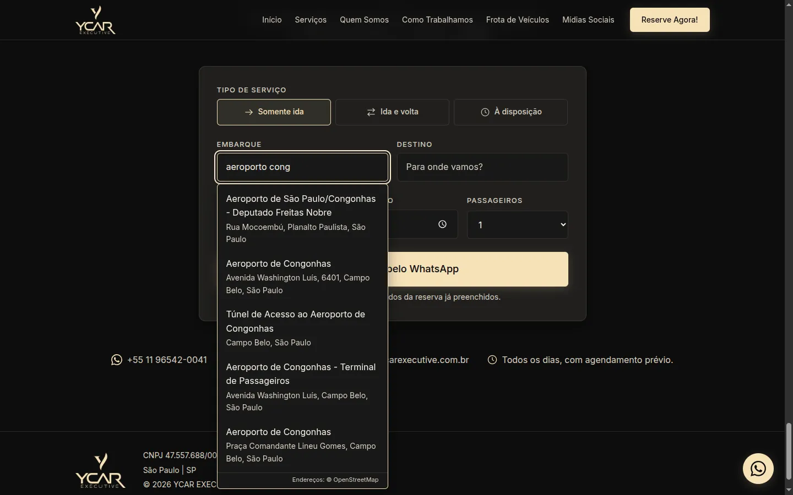
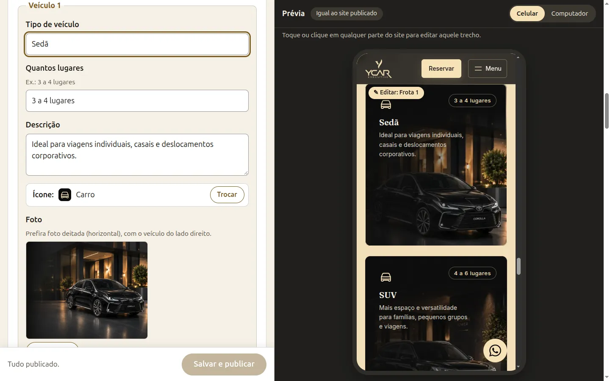

# YCAR EXECUTIVE — site institucional

Site da **YCAR EXECUTIVE**, empresa de transporte executivo em São Paulo: transfer executivo,
receptivo em aeroportos, viagens, operação à disposição, city tour, motoristas bilíngues e frota
do sedã ao ônibus, incluindo blindados e segurança armada.

**No ar: <https://ycarexecutive.com.br>**


Formulário de reserva, com as sugestões de endereço abertas ao digitar "aeroporto cong":



No celular, o topo e o menu:

<p>
  
  
</p>

Painel `/admin`: o formulário de edição à esquerda e a prévia ao vivo à direita. Clicar num cartão
da prévia abre o campo correspondente:



## Stack

- **Angular 22** com componentes standalone, `ChangeDetectionStrategy.OnPush` e signals
- **SSG**: `outputMode: "static"`, uma única rota pré-renderizada em build, hidratada no cliente
- **SCSS** com design tokens em [src/styles/\_tokens.scss](src/styles/_tokens.scss)
- **Cloudflare Workers** servindo os assets estáticos e a API do painel ([wrangler.jsonc](wrangler.jsonc))
- Fontes self-hosted (Inter e Fraunces) — nenhuma requisição a terceiros ao carregar a página
- Formulário de reserva resumido que monta a mensagem do WhatsApp; os campos de endereço sugerem
  lugares pelo [Photon](https://photon.komoot.io) (OpenStreetMap, gratuito, sem chave), consultado
  só quando a pessoa digita 3+ letras

## Como rodar

```bash
npm install
npm start          # http://localhost:4200
```

Build de produção em `dist/ycar-site/browser`:

```bash
npm run build
```

Deploy: cada push em `main` dispara o Workers Builds, que roda `npm run build` e
`npx wrangler deploy`. Para publicar na mão (o `wrangler` não é dependência do projeto; o `npx` o
baixa na hora):

```bash
npm run build && npx wrangler deploy
```

Testes:

```bash
npm test                              # specs do Angular (Vitest), ex.: sugestões de endereço
node --test worker/index.test.mjs     # API do painel, sem dependência
```

## Estrutura

```
src/
  app/
    components/     uma seção do site por arquivo (hero, services, fleet, about, …),
                    o formulário de reserva e o campo de endereço com sugestões
    content/        conteudo.json (textos editáveis) + site-content.ts (tipos e derivados)
    directives/     parallax, reveal-on-scroll, count-up
  styles/           design tokens
public/
  images/           fotos em WebP, com variantes responsivas
  fonts/            woff2 com subset dos glifos usados
  admin/            painel /admin (HTML + JS puro, fora do bundle do site)
worker/             API do painel (login e publicação via GitHub)
scripts/            utilitários de build de assets
docs/               PRD e plano de implementação
```

Todo o texto visível vive em [src/app/content/conteudo.json](src/app/content/conteudo.json), que é
o arquivo que o painel edita. [site-content.ts](src/app/content/site-content.ts) tipa esse JSON e
deriva o resto (link do WhatsApp, telefone formatado, menu, JSON-LD). Editar conteúdo é mexer no
JSON, nunca no template de um componente. Como o painel também commita nesse arquivo, **dê
`git pull` antes de mexer no projeto**.

## Painel `/admin`

Página com senha em <https://ycarexecutive.com.br/admin/> para editar sem depender de
desenvolvedor: WhatsApp e mensagem automática, Instagram, horário, textos de todas as seções, nomes
do menu, CNPJ e endereço do rodapé e os cartões de serviços e frota (adicionar, remover, reordenar,
trocar ícone e foto). O link da agenda de reservas é opcional: vazio, todos os botões de reserva
abrem o WhatsApp.

Ao lado do formulário fica uma **prévia ao vivo**: o próprio site num iframe (`/?previa=1`), que
recebe o conteúdo em edição a cada tecla — inclusive fotos ainda não publicadas. Clicar num trecho
da prévia abre o campo correspondente; focar um campo destaca o trecho na prévia. No celular a
prévia abre em tela cheia pelo botão "Ver prévia". Por isso o conteúdo em
[site-content.ts](src/app/content/site-content.ts) é `signal`/`computed`: no site publicado ele
nunca muda; na prévia, `window.ycarPrevia` (registrado em [main.ts](src/main.ts) só dentro do
iframe com `?previa`) troca o valor.

Como funciona:

1. O painel ([public/admin](public/admin)) carrega o `conteudo.json` atual pela API do Worker
   ([worker/index.mjs](worker/index.mjs)).
2. Fotos são reduzidas no navegador para 900/672/560/400 px (WebP, ou JPG onde não há encoder
   WebP), com nome novo a cada envio porque as imagens têm cache de 1 ano.
3. "Salvar e publicar" envia tudo ao Worker, que valida o formato (mesmas chaves e tipos do JSON
   atual) e faz **um commit** em `main` com o JSON e as fotos.
4. O Workers Builds refaz o site em ~2 min. Se o build falhar, o site continua na versão anterior.
   Para desfazer uma publicação, basta reverter o commit.

Secrets do Worker (uma vez só):

```bash
npx wrangler secret put ADMIN_SENHA    # senha do painel, 12+ caracteres
npx wrangler secret put GITHUB_TOKEN   # fine-grained token: só este repo, Contents read/write
```

Sem os dois, a API responde 503 e o painel fica fechado. Trocar `ADMIN_SENHA` desconecta todas as
sessões abertas. O login tem limite de 5 tentativas por minuto por IP.

Os desenhos dos ícones do painel são cópia dos de [icon.ts](src/app/components/icon.ts): ao mudar
ou criar um ícone lá, atualize `SVG_ICONES` e `ICONES` em [admin.js](public/admin/admin.js).

Para rodar a API localmente, crie `.dev.vars` (fica fora do git) com `ADMIN_SENHA` e
`GITHUB_TOKEN`, e rode `npm run build && npx wrangler dev`.

## Imagens responsivas

As fotos dos cards de serviços e frota são servidas via `srcset` nas larguras 400/560/672/900. O
arquivo sem sufixo é a maior (900w) e serve de fallback; as variantes ficam ao lado dele como
`<nome>-<largura>.webp`.

**Ao adicionar ou trocar uma foto em `public/images/servicos` ou `public/images/frota`, rode:**

```bash
python3 scripts/gerar-variantes-imagens.py
```

Sem isso o `srcset` aponta para arquivos que não existem. As larguras geradas precisam continuar
espelhando `LARGURAS_CARD` em `site-content.ts`.

## Decisões de performance

O site é a primeira impressão de um cliente que muitas vezes abre o link no 4G, andando pelo
aeroporto. Algumas escolhas existem por causa disso:

- **Sem `@angular/router`.** A navegação é por âncoras e não existe `router-outlet`, então o router
  saía do bundle sem perder nada — cerca de 30 KiB de transferência.
- **Fontes com subset.** Os `.woff2` em `public/fonts` contêm apenas os glifos usados no site
  (latim com acentuação pt-BR e pontuação tipográfica), não o subset `latin` inteiro. Trocar uma
  fonte significa gerar o subset de novo, e um caractere fora do conjunto cai no fallback do
  sistema.
- **Imagem do hero antes das fontes no `<head>`.** Ela cobre a tela inteira no primeiro quadro, e a
  ordem dos `preload` em [src/index.html](src/index.html) é intencional. No PageSpeed o elemento de
  LCP é o título (h1), não a foto.
- **Tudo em WebP.** Nenhum PNG de conteúdo — só o ícone do iOS e a imagem de Open Graph, que não
  são baixados na renderização da página.

No PageSpeed de outubro de 2026 o site tirou 95 no celular e 100 no computador em desempenho, e
100 em acessibilidade, práticas recomendadas e SEO.

## Domínio e hospedagem

- O domínio `ycarexecutive.com.br` está registrado no Registro.br, com o DNS na Cloudflare.
- `ycarexecutive.com.br` e `www.ycarexecutive.com.br` são Custom Domains do Worker (`routes` em
  [wrangler.jsonc](wrangler.jsonc)). A Cloudflare cria o DNS e o certificado HTTPS.
- Uma Redirect Rule da zona manda `www` para o domínio principal (301, mantendo a query string), e
  **Sempre usar HTTPS** redireciona `http://` para `https://`.
- O endereço `*.workers.dev` continua respondendo, mas o `canonical` aponta para o domínio.
- No Google Search Console o domínio está verificado por um registro TXT
  (`google-site-verification=…`) na Cloudflare. **Não apague esse registro**: sem ele a verificação
  cai. O sitemap está enviado.

## Acessibilidade

Contraste AA verificado nas duas paletas (escura e bege), alvos de toque de no mínimo 44px, menu
mobile em `<dialog>` nativo com foco gerenciado, e animações de entrada que respeitam
`prefers-reduced-motion`. Sem JavaScript, nenhum conteúdo fica oculto: os estados iniciais de
animação só se aplicam sob `html.js`.
